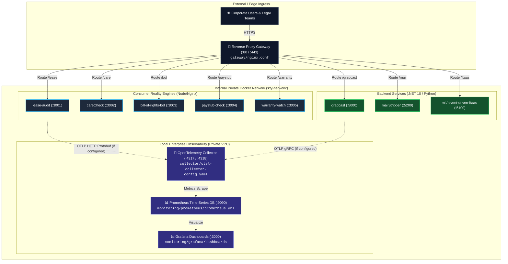
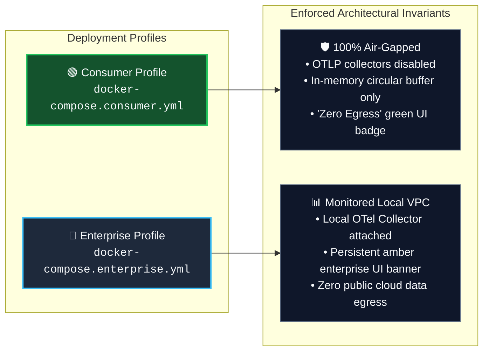

<!-- diagram-meta
  last-validated: 2026-10-19
  covers: [collector/**, helm/**, monitoring/**, gateway/**, docker-compose*.yml]
  generated-by: manual
-->

# Architecture & Orchestration Specification: Enterprise Self-Host

> Production Docker Compose, Helm chart, OpenTelemetry Collector, and reverse-proxy deployment harness for the `knowthankyew` portfolio.

---

## 1. Executive Summary

`enterprise-self-host` provides the infrastructure orchestration harness for deploying the complete `knowthankyew` suite within enterprise VPCs, private Kubernetes clusters, or air-gapped on-premise environments. It demonstrates the portfolio's core architectural pattern: client applications remain air-gapped and zero-egress by default in consumer profiles, while enterprise profiles enable local OpenTelemetry aggregation via an explicit build-time shim without code changes or upstream forks.

---

## 2. System Architecture & Deployment Topology

### A. Container Topology & Network Isolation



### B. Dual-Profile Execution Boundary



---

## 3. Core Architectural Invariants

| # | Invariant | Description & Enforcement |
|:--|:----------|:--------------------------|
| 1 | **Air-Gap Verification Gate** | Automated harness `verify-selfhost.sh` spins up stacks and verifies zero unexpected outbound network connections via socket inspection. |
| 2 | **Local-Only Observability** | In enterprise mode, all metrics and traces remain inside the local Docker network / VPC; zero external SaaS telemetry beacons. |
| 3 | **Dynamic UI Honesty** | Applications launched under the enterprise profile automatically show the amber `[ENTERPRISE (OTLP)]` banner via `getPrivacyClaims()`. |
| 4 | **Universal Nuclear Burn Orchestration** | Shell script `burn-telemetry.sh` broadcasts atomic purge signals across all running containers and storage mounts. |
| 5 | **Kubernetes / Helm Production Readiness** | Ready-to-deploy Helm charts (`helm/`) specifying resource limits, liveness probes, and non-root security contexts. |

---

## 4. Directory Structure

```
enterprise-self-host/
├── docker-compose.yml           # Base orchestration across all 12 services
├── docker-compose.consumer.yml  # Zero-egress public profile override
├── docker-compose.enterprise.yml # Local OTel collector profile override
├── collector/
│   └── otel-collector-config.yaml # OpenTelemetry pipeline & receivers
├── gateway/
│   └── nginx.conf               # Unified reverse proxy routing
├── monitoring/
│   ├── prometheus/
│   │   └── prometheus.yml       # Prometheus scrape configurations
│   └── grafana/
│       └── dashboards/          # Grafana pre-built portfolio dashboards
├── helm/                        # Production Kubernetes Helm chart
├── burn-telemetry.sh            # Global amnesiac state purge orchestrator
├── clone-siblings.sh            # Sibling repository sync script
├── verify-selfhost.sh           # Automated integration & air-gap validation test
├── start.sh                     # Launch runner
└── stop.sh                      # Teardown script
```
